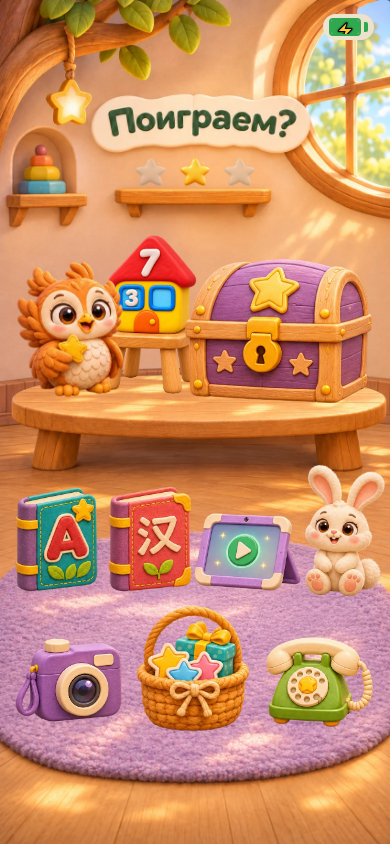

# Детская часть: волшебная комната

17 ноября 2026. Интерфейс для детей 3–6 лет.

## Дополнение: комната как общий вход

Опубликовано 17 ноября: `fa7f9faa92b1b8a8a16c974190f21df6538e0c69`, Railway kid-web `f4676104-bdb4-4c81-9719-3cbfe8e0c40c`, SUCCESS. Владелец явно попросил остановить проверки и опубликовать текущее состояние. Основная проверка CI успешна, полный браузерный набор отменён до завершения. На рабочем сайте проверены HTTP страницы/JS, сборка `fa7f9fa`, API/БД, непривязанное устройство и фон комнаты: [результат](child-playroom/room-entry/result.json), [CI](child-playroom/room-entry/ci.json). Дополнительный браузерный прогон после публикации не выполнялся.

В `a341833` комната стала главным экраном с учебным планом и без него, включая один назначенный раздел или пустой плейлист. Игрушки открывают только назначенные занятия с учётом правил плана. Из разделов и после отложенного квиза ребёнок возвращается в комнату; режим малыша сохранён. Вложенная панель яркости работает поверх «Моего уголка» и закрывается отдельно от него.

Локально прошли 437 модульных тестов, проверки типов, ESLint и Prettier. Пять новых сценариев входа проверены на Galaxy S20 в двух ориентациях, iPhone 15 и iPhone SE. Также проверены возврат, расписание, ночь, дела и работа без сети. В `6e01877` обновлены ожидания возврата после звонка и ошибок видео, проверка языка внутри английского урока и порядок действий в тесте узкого пазла. После исправлений прошли 46 соответствующих сценариев.

Первый прогон WebKit упёрся в лимит 55 минут: общий вход добавился ко всем тестам занятий. В `76626a0` полный набор разделён на шесть параллельных частей без сокращения покрытия. В подготовке тестов занятий временно уменьшается движение комнаты, затем исходная настройка восстанавливается; фактическое время входа добавляется к бюджету занятия. Ещё 12 сценариев WebKit прошли локально.

Прогон `76626a0` выявил два сбоя времени тестов на iPhone 15: повторный вход начинался слишком близко к дедлайну, а порог отдыха учитывал длительность навигации. В `a713ee9` вход получает ограниченный запас заранее с последующим учётом только потраченного времени; порог отдыха проверяется с остановленными часами и входом через планшет. Все восемь соответствующих сценариев прошли локально.

В CI `a713ee9` прошли обе части Android, обе части iPhone SE и первая часть iPhone 15. Во второй части iPhone 15 осталось четыре ошибки; по трассировкам задержки команд и рендеринга меняли длительность удержания и ритм, а отдых успевал начаться до видео. В `fa7f9fa` эти проверки используют управляемые часы; вход ждёт диалога сундука отдельно от его содержимого. Локально прошли 22 из 24 сценариев, затем после последней правки оставшихся двух — все восемь проверок ритма/PIN на четырёх конфигурациях. [Полный CI](https://github.com/almash591-sudo/kidsplus-app/actions/runs/44035118942) отменён по просьбе владельца.

Общий вход устраняет обход комнаты в свободном режиме. Предметные переходы внутри сцены, меню сундука и композиция для низких и горизонтальных экранов остаются следующими задачами.

## Предыдущий релиз `0f9bb3e`: что изменилось

- В режиме учебного плана главный экран — комната с утренним, дневным и вечерним светом. Предметы открывают существующие занятия: книги, планшет, сундук, камера, телефон и корзинка с наклейками.
- Книги и сундук открываются, совёнок и зайчик реагируют на касания. Короткие голосовые подсказки помогают без чтения. Режим уменьшенного движения поддерживается.
- Разделы занятий, карточки, тесты, альбом, дела, аудиотека, камера, галерея и звонки продолжают оформление комнаты. Крупные иллюстрации и кнопки заменяют плотные списки.
- Рисовалка, раскраска, сортировка, «Найди пару» и пазл получили отдельные рабочие столы. В сортировке и пазле можно выбирать предмет и место двумя касаниями, а также перетаскивать. Пазл показывает до шести свободных частей одновременно и добавляет следующие по мере сборки.
- Прогресс пары и пазла сохраняется при повороте. Завершение закрытой игры не начисляет награду; повторное событие завершения блокируется.
- Карточки видео получают уже одобренное родителем название из API. Поле необязательное для совместимости со старым API.

Расписание, лимиты, паузы и PIN родителя сохранены. Другие игры сохраняют собственные сцены и механику, с общими материалами элементов управления. Персонажи и предметы — растровые слои с анимацией, а не полноценные трёхмерные модели.

## Проверка

- Локальные тесты всех пакетов: 1150 успешных тестов. API и worker проверены отдельно с ограниченной параллельностью из-за потребления памяти PGlite.
- Браузерные проверки комнаты: освещение, открывание предметов, маршруты, правила доступа, фокус, уменьшенное движение и отсутствие ошибок JavaScript.
- Проверки новых жестов пары и пазла: 20 успешных сценариев на Galaxy S20 в двух ориентациях, iPhone 15 и iPhone SE. Дополнительно проверены максимальные поля и сборка 16 частей с пополнением лотка на четырёх размерах от 320×568 до 915×412.
- Финальная проверка прямоугольных пазлов обнаружила зоны нажатия шириной всего 17 px. Лоток теперь учитывает пропорции деталей, а каждая кнопка имеет размер не меньше 48×48 px без искажения картинки. После исправления прошли 28 сценариев пары и пазла в Chromium и WebKit, включая полоски 1×4 и 4×1, поворот и ошибочное перетаскивание к краю. Восемь максимальных игровых полей проверены повторно.
- Проверены навигация по десяти разделам, награда и просмотр наклейки, подсказки при бездействии и вход родителя с неверным и верным PIN на четырёх конфигурациях телефонов.
- Итоговый браузерный прогон: 108 успешных сценариев, включая расписание, дела, наклейки, озвучку, пару и пазл, в Chromium и WebKit.
- Полный CI выявил устаревшие ожидания цвета темы и размеров обложки относительно кнопки. Проверка тёмного режима теперь подтверждает включённую системную тему и сохраняет порог контраста текста выше 7:1. Обложка заполняет внутреннюю иллюстрированную область карточки; восстановлено заполнение этой области у книг и стихов. Восемь сценариев чтения, вопросов, закладки и контраста прошли после исправления на всех четырёх конфигурациях.
- Визуальная проверка: одинаковый масштаб, общие снимки и крупные фрагменты шапок мастерских. Иллюстрации, Nunito с кириллицей, кремовая бумага и деревянные поверхности соответствуют принятому направлению.

Полный [CI для `0f9bb3e`](https://github.com/almash591-sudo/kidsplus-app/actions/runs/43826338051) завершён успешно: check, e2e, e2e-iphone, e2e-phone и kiosk. После возобновления сессии ранее пропущенный деплой выполнен вручную из main; API и kid-web опубликованы на этом коммите, оба имеют статус SUCCESS.

На [рабочем сайте](https://kid-web-production.up.railway.app/) проверены связь с БД, страница подключения, идентификатор сборки, SHA-256 всех 21 изображения комнаты, список precache и заголовки кэширования. Комната и рисовалка открыты в Chromium и WebKit на 390×844, 320×568 и 568×320 без ошибок JavaScript; в сценариях привязанного устройства API заменён демонстрационными ответами. Итоговый [отчёт проверки](child-playroom/deployment/result.json) и [подтверждение CI](child-playroom/deployment/ci.json) сохранены в репозитории. CSP не изменялся: подтверждены обработанная проверка возможностей Zod и служебная вставка стилей инструментом снимков WebKit.

Фактические звук, камера, датчики, звонки и плавность на физических телефонах требуют отдельной проверки; браузерные подмены устройств её не заменяют. Полностью автономная работа установленного PWA в этой проверке не проверялась. Точка продолжения — [SESSION_HANDOFF.md](SESSION_HANDOFF.md).

## Визуальные доказательства

